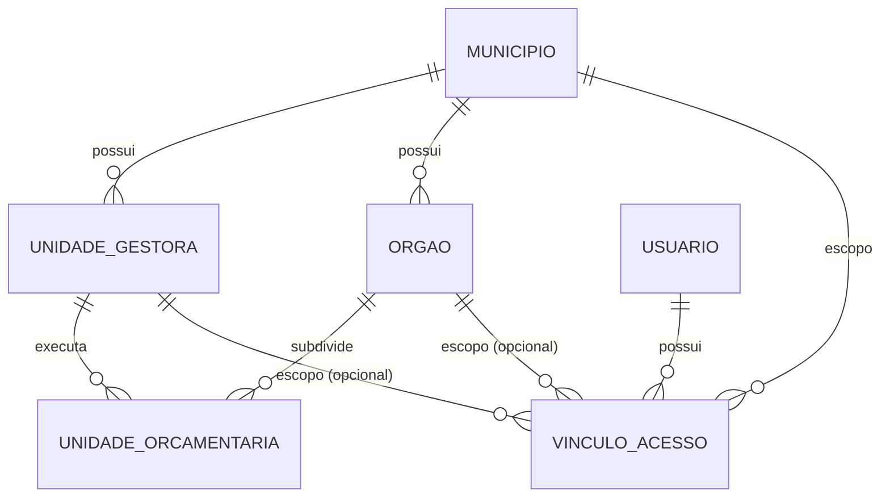
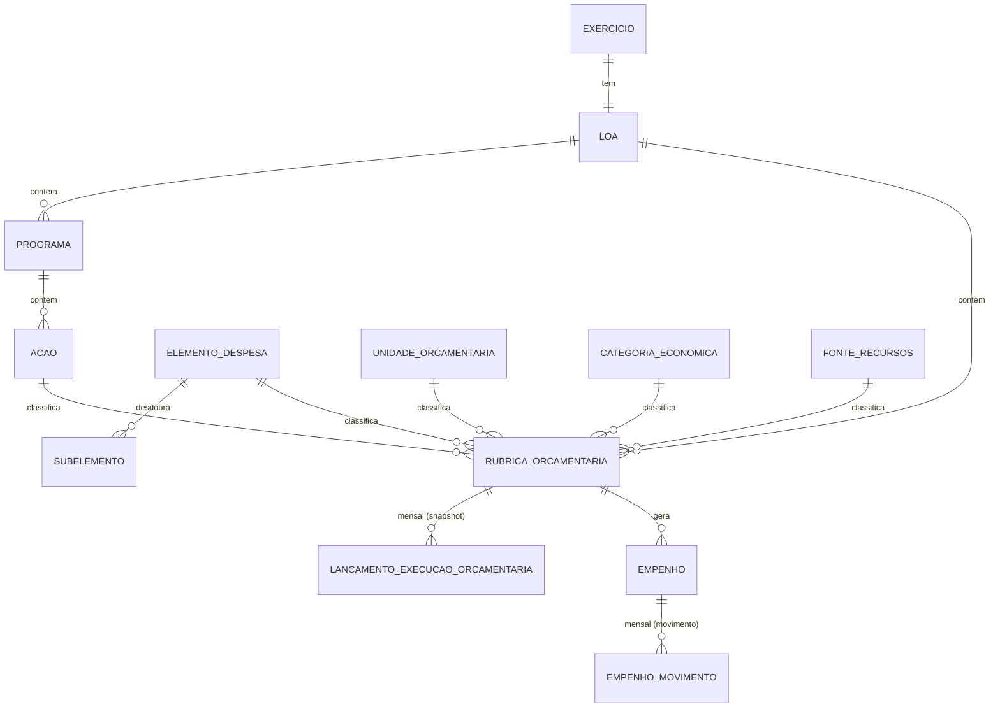
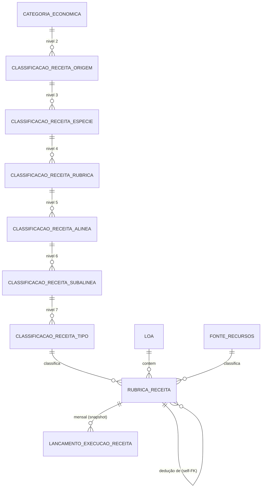
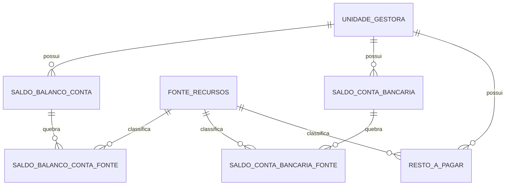
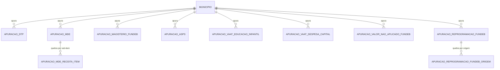
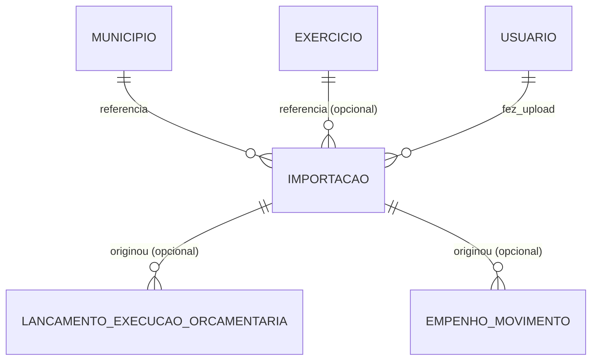

# Modelagem de Dados — DUAL_CASP

Data dictionary e auditoria de arquitetura de dados do backend Django do CASP (sistema de controle orçamentário/fiscal municipal). Cobre os 7 apps do projeto (`usuarios`, `municipios`, `orcamento`, `fiscal`, `financeiro`, `execucao_fiscal`, `importacao`) — 40 models no total. Ver `CLAUDE.md` na raiz do repo para a arquitetura narrativa completa (pipeline de import PDF→model, histórico de decisões, domínio de negócio); este documento é a referência estrutural — campos, tipos, relações, constraints — mais uma auditoria de qualidade de schema e o racional de granularidade import-vs-cadastro.

**Como foi gerado**: um script de introspecção (`backend/scripts/exportar_modelagem.py`, ver Apêndice) lê `django.apps` diretamente — não é uma transcrição manual, reflete o schema real aplicado no banco no momento em que roda. **Atenção**: rodar o script sobrescreve este arquivo inteiro com o dump bruto de introspecção — depois de rodá-lo, as seções 1-5 e o formato em tabela da seção 6 precisam ser reescritos por cima do dump, ele não as preserva.

---

## 1. Sumário executivo

O sistema tem duas vias de entrada de dado por "fato" (tabela transacional — dotação, execução, empenho, apuração fiscal etc.): **import automático** (PDF/planilha ASPEC → parser → service, `apps/importacao/`) e **cadastro manual** (API REST → frontend React). As duas vias gravam no mesmo model, nunca em tabelas paralelas — a distinção fica em `origem_registro` (`IMPORTADO`/`MANUAL`), não na estrutura.

Esta rodada de profissionalização (DBA, 2026-11-11) cobriu:
- **Auditoria de 10 categorias de qualidade de schema** (índices, `on_delete`, nomenclatura, timestamps, constraints, migrations) — 13 achados, com correção imediata para 11 deles (ver §4).
- **Refator de granularidade** nos dois models com pior assimetria import-vs-cadastro: `ApuracaoMDE` (11 colunas de sub-item de receita) e `ApuracaoReprogramacaoFundeb` (10 colunas de sub-item por origem) foram normalizados em tabelas filhas, seguindo o padrão já validado em produção (`SaldoBalancoContaFonte`/`SaldoContaBancariaFonte`) — ver §5.
- Reescrita deste documento de um dump bruto de introspecção para um data dictionary padronizado.

---

## 2. Convenções e padrões

### 2.1 Nomenclatura
- Campos em português, `snake_case`. Catálogos oficiais (STN/SOF) sempre têm `codigo`+`nome`.
- **Exceções conhecidas e aceitas** (não corrigidas nesta rodada — custo de renomear, inclusive em parsers/serializers/`types.ts`/frontend, desproporcional ao ganho cosmético):
  - `fiscal.RubricaReceita.eh_deducao` — único booleano do projeto com prefixo `eh_` (resto usa adjetivo nu, ex. `ativo`).
  - `usuarios.Usuario.is_equipe_escritorio` — mistura o prefixo `is_` herdado de `AbstractBaseUser`/`PermissionsMixin` (`is_active`, `is_staff`, `is_superuser`) com um campo próprio do domínio.
  - `financeiro.RestoAPagar.rpp_pago`/`rpnp_pago` — siglas (Restos a Pagar Processados/Não Processados) num model onde todo o resto é escrito por extenso.

### 2.2 Timestamps
Todo model com `AuditoriaMixin` (rastreia `criado_por`/`atualizado_por`) agora também tem `criado_em`+`atualizado_em` — antes desta rodada, 8 models tinham `atualizado_por` sem o `atualizado_em` correspondente (sabia *quem* editou por último, não *quando*). Corrigido em `RubricaOrcamentaria`, `LancamentoExecucaoOrcamentaria`, `Arrecadacao`, `SaldoBalancoConta`, `SaldoContaBancaria`, `RestoAPagar` e, via `ApuracaoFiscalBase`, nos 8 models de `execucao_fiscal`.

### 2.3 Padrão `origem_registro` + `AuditoriaMixin` (import vs. cadastro manual)
Dois mixins abstratos em `apps.orcamento.models`, reaproveitados por todo "fato" do projeto:
- **`OrigemRegistroMixin`** — campo `origem_registro` (`IMPORTADO`/`MANUAL`, default `IMPORTADO`, indexado). Commands de import (`manage.py importar_*`) chamam `services.py` direto pela ORM, sem passar pela API — nunca stampam `MANUAL`. Escritas via API (`RegistroManualMixin.perform_create`/`perform_update`, `apps/usuarios/mixins.py`) sempre stampam `MANUAL` + o usuário autenticado.
- **`AuditoriaMixin`** — `criado_por`/`atualizado_por` (FK `Usuario`, `SET_NULL`, nulo quando a escrita veio de um management command).

**Semântica de reimportação**: todo import substitui (delete+recreate ou upsert por chave natural) o escopo que acabou de reler — nunca soma incrementalmente. Uma correção manual feita entre duas importações do mesmo arquivo é perdida na próxima reimportação; o frontend avisa disso (`AcoesRegistroManual`, banner "origem IMPORTADO") mas não impede a edição.

### 2.4 Política de `on_delete`

| Tipo de relação | Política | Exemplos |
|---|---|---|
| Catálogo nacional/oficial referenciado por um fato (nunca deve ficar órfão) | `PROTECT` | `RubricaOrcamentaria.elemento_despesa`, `RubricaReceita.classificacao_tipo`, todo FK de fato → `FonteRecursos`/`UnidadeGestora`/`Municipio` |
| Container lógico cujo filho só existe dentro dele (linha morre com o pai) | `CASCADE` | `*Fonte` → `Saldo*`, `ApuracaoMDEReceitaItem`/`ApuracaoReprogramacaoFundebOrigem` → apuração pai, `EmpenhoMovimento` → `Empenho` |
| Enriquecimento opcional, best-effort (perder o link não invalida o registro) | `SET_NULL` (sempre com `null=True, blank=True`) | `RestoAPagar.orgao`/`unidade_orcamentaria`/`elemento_despesa` (enriquecimento de `FICHAS_RESTOS.PDF`), `RubricaReceita.rubrica_principal` (self-FK: se a dedução perde o link pro "principal" ao ele ser apagado, a linha continua válida) |

**Corrigido nesta rodada** (3 inconsistências reais, onde o mesmo tipo de relação usava política diferente sem explicação documentada):
- `financeiro.SaldoBalancoConta/SaldoContaBancaria/RestoAPagar.unidade_gestora`: `CASCADE` → `PROTECT` (alinhado com `orcamento`/`fiscal`, que já protegiam o mesmo FK — apagar uma UG não deve mais silenciosamente apagar todo o histórico financeiro).
- `fiscal.Arrecadacao.municipio`: `CASCADE` → `PROTECT` (único FK para `Municipio` no projeto inteiro que não protegia).
- `orcamento.RubricaOrcamentaria.loa` / `fiscal.RubricaReceita.loa`: `CASCADE` → `PROTECT` (evita que apagar uma LOA falhe no meio de um cascade com `ProtectedError` confuso, assim que ele alcança um `Empenho`/`LancamentoExecucaoReceita` já `PROTECT`ido — agora bloqueia imediatamente, com mensagem clara).

**Revisado e mantido como está** (parecia inconsistência, não era): `RubricaReceita.classificacao_tipo` (`PROTECT`) vs. `rubrica_principal` (`SET_NULL`) — são relações semanticamente diferentes (classificação oficial nunca órfã vs. link de conveniência entre duas linhas do mesmo cadastro).

---

## 3. Diagramas ER por domínio

### 3.1 Usuários / Municípios (`usuarios`, `municipios`)

Escopo de acesso multi-tenant — não é uma árvore estrita: `Orgao` e `UnidadeGestora` são irmãos sob `Municipio`, `UnidadeOrcamentaria` é o ponto de junção (um órgão pode ter unidades em UGs diferentes).



### 3.2 Orçamento — Despesa (`orcamento`)

`RubricaOrcamentaria` é o centro de um esquema estrela: a combinação completa de classificação (organizacional + funcional-programática + econômica + fonte) para uma LOA. `Empenho`/`EmpenhoMovimento` e `LancamentoExecucaoOrcamentaria` penduram dela.


*(Omitidos do diagrama por brevidade, mas presentes no schema: `Funcao`/`Subfuncao`/`GrupoNaturezaDespesa`/`ModalidadeAplicacao` — mesmo papel de classificação FK em `RubricaOrcamentaria` que `CategoriaEconomica`/`ElementoDespesa` acima.)*

**`Empenho`/`EmpenhoMovimento`**: split deliberado, não normalização por normalização — o relatório mensal ASPEC só reporta a *movimentação* daquele mês para um empenho, não o acumulado; `Empenho.valor_empenho/liquidado/pago` são agregados **sempre recalculados** a partir de `EmpenhoMovimento`, nunca escritos diretamente.

### 3.3 Fiscal — Receita (`fiscal`)

Mesmo papel de `RubricaOrcamentaria`, mas sem dimensão organizacional (receita não se vincula a uma estrutura administrativa executora). Os 7 níveis do Ementário STN de receita; nível 1 (Categoria Econômica) é **compartilhado com despesa** via `orcamento.CategoriaEconomica` (ver §2.4 em `CLAUDE.md` — chave de cruzamento é `natureza`, não `codigo`).


`Arrecadacao` (transação individual, regime de caixa — `ARRECADACAO`/`ANULACAO`) existe à parte, sem FK para `RubricaReceita` (fonte dormente desde que `LancamentoExecucaoReceita` assumiu como fonte ativa de execução de receita — mantida, não removida, por não ser destrutivo).

### 3.4 Financeiro (`financeiro`)

Três relatórios independentes, todos com o mesmo padrão pai→filho-por-fonte.



### 3.5 Execução Fiscal (`execucao_fiscal`)

8 índices constitucionais/LRF, todos no formato `(município, exercício, bimestre)` — sem dimensão UG/órgão (índice é do município inteiro). `ApuracaoMDE` e `ApuracaoReprogramacaoFundeb` têm tabela filha (refator desta rodada, §5); os outros 6 são planos.



### 3.6 Importação (`importacao`)

`Importacao` registra o upload/processamento de um arquivo; hoje só rastreia metadado (status, usuário, exercício) — o upload salva o arquivo mas o dispatch para o parser certo ainda é manual via `management command` (não implementado). Dois fatos de `orcamento` guardam um FK opcional (`SET_NULL`) de volta para o registro de import que os criou.



---

## 4. Auditoria de qualidade de schema

Auditoria DBA (2026-11-11) contra 10 categorias, lendo `apps/*/models.py` + `apps/*/migrations/*.py` de todos os 7 apps. Status: ✅ corrigido nesta rodada · 📝 documentado, sem correção (motivo explícito) · ✔️ avaliado, já estava correto.

| # | Categoria | Achado | Status |
|---|---|---|---|
| 1 | Índices faltando | `EmpenhoMovimento.mes_referencia`, `Arrecadacao.mes_referencia` (standalone), `SaldoContaBancaria.data_referencia` sem índice, inconsistentes com pares diretos já indexados | ✅ `db_index=True` adicionado |
| 1 | Índices faltando | `ApuracaoFiscalBase.exercicio`/`.bimestre` (8 models), `OrigemRegistroMixin.origem_registro` (~15 fatos), `ClassificacaoOficialMixin.ativo` + `ativo` de `municipios.*` (15 models), `Exercicio.ano` sem índice | ✅ `db_index=True` adicionado em todos |
| 2 | `on_delete` inconsistente | Ver §2.4 — 3 FKs corrigidos (`financeiro.*.unidade_gestora`, `Arrecadacao.municipio`, `*.loa`) | ✅ |
| 2 | `on_delete` inconsistente | `RubricaReceita.classificacao_tipo` (PROTECT) vs. `rubrica_principal` (SET_NULL) | ✔️ relações semanticamente diferentes, mantido |
| 3 | Precisão decimal | Dinheiro sempre `(18,2)`, percentual sempre `(7,4)` — 100% consistente em todo o projeto | ✔️ limpo, sem ação |
| 4 | Nomenclatura | `eh_deducao`, `is_equipe_escritorio`, `rpp_pago`/`rpnp_pago` — ver §2.1 | 📝 custo de renomear desproporcional ao ganho cosmético |
| 5 | Nullable/blank | Nenhuma violação — todo `null=True` pareado com `blank=True` em todo o projeto | ✔️ limpo, sem ação |
| 6 | Timestamps | 8 models com `atualizado_por` sem `atualizado_em` correspondente — ver §2.2 | ✅ `atualizado_em` adicionado |
| 7 | Migrations frágeis | `fiscal/migrations/0005_...` tem `RunSQL` com PKs hardcoded (remapeamento manual confirmado por inspeção do banco) + `reverse_sql=noop` (irreversível) | 📝 já aplicada; não mexer — só reconferir os PKs se replay num ambiente novo |
| 8 | Unique constraints faltando | `SaldoBalancoContaFonte`/`SaldoContaBancariaFonte` sem `UniqueConstraint(conta, fonte_recursos)`; `Arrecadacao` sem constraint na chave natural (único fato do projeto sem proteção no banco) | ✅ adicionadas (checado antes: zero duplicatas existentes) |
| 8 | Unique constraints incompletas | `VinculoAcesso`'s constraint não pega duplicatas quando `unidade_gestora`/`orgao` são `NULL` (NULL≠NULL em SQLite/Postgres) — caso mais comum (acesso a município inteiro) podia duplicar | ✅ 3 `UniqueConstraint` condicionais adicionadas (uma por combinação de campo nulo) |
| 9 | `@property` duplicando coluna | Nenhuma duplicação real encontrada — o projeto já tinha corrigido 2 casos antes desta auditoria (`ApuracaoMDE.valor_considerado_apos_deducoes`, `ApuracaoDTP.deducoes_rcl`, ambos removidos como coluna e convertidos em `@property` em migrations anteriores) | ✔️ limpo, sem ação |
| 10 | Check constraints | `CheckConstraint` nunca usado no projeto inteiro | ✅ `bimestre BETWEEN 1 AND 6` adicionado aos 8 models de `execucao_fiscal` — **não** adicionado range 0-100% em percentuais (DTP pode legitimamente passar de 100% da RCL numa crise fiscal extrema; um CHECK rígido arriscaria rejeitar um reimport de dado real) |

**Nota de implementação do CheckConstraint de bimestre**: teve que ir no `Meta.constraints` de cada um dos 8 models concretos, não só na `ApuracaoFiscalBase.Meta` abstrata — cada subclasse já redeclara `constraints = [UniqueConstraint(...)]` no próprio `Meta`, o que *substitui* (herança Python simples de atributo de classe, não merge) o que viria da base.

---

## 5. Refator de granularidade — import vs. cadastro manual

**Motivação original**: dois models tinham "grupos repetidos" como colunas paralelas em vez de linhas filhas — o anti-padrão clássico de 1FN que o projeto já resolve corretamente em outro lugar (`SaldoBalancoContaFonte`/`SaldoContaBancariaFonte`, uma linha filha por fonte de recursos). Um cadastro manual desses dois models exigia preencher um formulário monolítico de ~25 campos decimais; o import de PDF precisava de um mapa fixo nome-de-campo→sub-item que teria que ser atualizado a cada novo tipo de sub-item.

**Normalizados** (seguindo exatamente o padrão `*Fonte` já validado em produção):

1. `execucao_fiscal.ApuracaoMDE` — as 11 colunas `receita_iptu`/`receita_itbi`/.../`receita_compensacoes` (sub-itens 1.1-1.4 "Receita de Impostos" e 2.1-2.7 "Receita de Transferências") viraram `ApuracaoMDEReceitaItem` (FK `CASCADE` → `ApuracaoMDE`, campos `grupo`/`codigo`/`rotulo`/`valor`). `ApuracaoMDE.receita_impostos`/`receita_transferencias` continuam na linha pai, só guardando o TOTAL de cada grupo (como o próprio relatório já traz).
2. `execucao_fiscal.ApuracaoReprogramacaoFundeb` — as 10 colunas `impostos_*`/`uniao_*` viraram `ApuracaoReprogramacaoFundebOrigem` (FK `CASCADE` → `ApuracaoReprogramacaoFundeb`, campo `origem` + os mesmos 5 campos do pai).

**Não normalizado**: `ApuracaoDTP`'s 4 deduções (`deducao_emendas_individuais`/`_bancada`/`_agentes_saude`/`_outras`) — conjunto fixo, pequeno, nomeado por lei (nunca cresce), não é um "grupo repetido" de verdade na prática.

**O que mudou, ponta a ponta**:
- Parser (`apps/importacao/parsers/aspec_rreo_mde.py`) monta uma lista de dicts (`mde["itens_receita"]`, `fundeb_reprogramacao["origens"]`) em vez de popular chaves fixas — uma linha numerada do relatório vira uma linha filha diretamente.
- Service (`importar_mde_e_magisterio`) faz `bulk_create` dos filhos depois de criar o pai.
- Serializers expõem `itens_receita`/`origens` como lista aninhada, **somente leitura** (mesmo padrão já usado pelos filhos `*Fonte`) — criação/edição de um item isolado via API não está implementada ainda, igual aos `*Fonte`.
- Frontend (`ExecucaoFiscalPage.tsx`/`ExecucaoFiscalDetalhadoPage.tsx`): o dialog de edição do pai perdeu os campos de sub-item (não existem mais como coluna flat); a visão pivotada/colapsável (`TabelaPivot`, grupos "1-Receitas de Impostos"/"19.1 Impostos") passou a procurar o valor na lista aninhada em vez de acessar a propriedade por nome fixo — a experiência visual não mudou, só a fonte do dado.
- Dado já importado (6 bimestres, exercício 2025) foi recriado do zero via reimport (`manage.py importar_mde`), não por uma data migration — mesma semântica de "reimportar substitui" já usada em todo o resto do projeto. Valores conferidos a centavo contra os já validados antes do refator (ex. bim.1 IPTU R$366.556,96, TOTAL GERENCIAL 1 R$3.546.188,38).

**Para granularidade futura semelhante** (candidatos NÃO tocados nesta rodada — fora do escopo pedido, mas com a mesma assimetria, se vier a doer em cadastro manual): `financeiro.SaldoBalancoConta`/`SaldoContaBancaria`/`RestoAPagar` já usam o padrão correto (pai + `*Fonte`); não há mais candidatos óbvios de "colunas paralelas" sobrando no schema atual.

---

## 6. Dicionário de dados

Por app. Campos reais (colunas); `@property` (campos computados, nunca persistidos) e constraints/índices listados à parte de cada model. `AuditoriaMixin` = `criado_por`/`atualizado_por` (FK `Usuario`, `SET_NULL`); `OrigemRegistroMixin` = `origem_registro` (`IMPORTADO`/`MANUAL`, indexado); `ClassificacaoOficialMixin` = `ativo` (indexado) + `origem_classificacao` + `ano_vigencia_inicial` + `criado_em`/`atualizado_em`.

### App `usuarios`

**`Usuario`** (`AbstractBaseUser`+`PermissionsMixin`) — login por CPF.
| Campo | Tipo | Notas |
|---|---|---|
| cpf | char(11) | único (USERNAME_FIELD) |
| nome_completo | char(150) | |
| email, telefone | char | opcionais |
| is_equipe_escritorio | bool | ver §2.1 (nomenclatura) |
| is_active, is_staff, is_superuser | bool | herdados do Django |
*(`cpf_formatado` — `@property`)*

**`VinculoAcesso`** — concede acesso a um escopo (município inteiro / UG inteira / órgão inteiro / órgão×UG específico, conforme `unidade_gestora`/`orgao` nulos ou não — ver §3.1).
| Campo | Tipo | Notas |
|---|---|---|
| usuario, municipio | FK CASCADE | |
| unidade_gestora, orgao | FK CASCADE, null | opcionais, independentes |
| papel | char(20) choices | ADMIN/GESTOR/ANALISTA/VISUALIZACAO — armazenado, não aplicado ainda |
Constraints: 1 `UniqueConstraint` cheia + 3 condicionais (ver §4, item 8).

### App `municipios`

| Model | Campos próprios | Constraint natural |
|---|---|---|
| `Municipio` | nome, uf (choices, 27 UFs), codigo_ibge, ativo | (nome, uf) |
| `UnidadeGestora` | municipio FK PROTECT, codigo, nome, poder (EXECUTIVO/LEGISLATIVO), cnpj, ativo | (municipio, codigo) |
| `Orgao` | municipio FK PROTECT, codigo, nome, ativo | (municipio, codigo) |
| `UnidadeOrcamentaria` | orgao FK PROTECT, unidade_gestora FK PROTECT, codigo, nome, ativo | (orgao, codigo) |

### App `orcamento`

| Model | Campos próprios (além de FKs de classificação) | Constraint natural |
|---|---|---|
| `Exercicio` | municipio FK PROTECT, ano, status (choices) | (municipio, ano) |
| `LOA` | exercicio FK 1:1 CASCADE, numero_lei, data_sancao, valor_total_receita_prevista, valor_total_despesa_fixada, observacoes | — (1:1 com exercicio) |
| `CategoriaEconomica` (+`ClassificacaoOficialMixin`) | codigo(1), nome, **natureza** (CORRENTE/CAPITAL/null — compartilhado despesa+receita, chave de cruzamento) | codigo |
| `GrupoNaturezaDespesa`/`ModalidadeAplicacao`/`ElementoDespesa` (+mixin) | codigo, nome | codigo |
| `Subelemento` (+mixin) | elemento FK PROTECT, codigo, nome | (elemento, codigo) |
| `FonteRecursos` | unidade_gestora FK PROTECT, codigo, nome, tipo (ORDINARIO/VINCULADO) | (unidade_gestora, codigo) |
| `Funcao`/`Subfuncao` | codigo, nome | codigo |
| `Programa` | loa FK CASCADE, codigo, nome, objetivo | (loa, codigo) |
| `Acao` | programa FK PROTECT, codigo, nome, tipo (PROJETO/ATIVIDADE/OPERACAO_ESPECIAL) | (programa, codigo) |
| `RubricaOrcamentaria` (+`OrigemRegistroMixin`+`AuditoriaMixin`) | loa FK **PROTECT**, 13 FKs de classificação (todas PROTECT), dotacao_inicial, origem_dotacao (choices, indexado) | 14 campos (classificação completa) |
| `LancamentoExecucaoOrcamentaria` (+mixins) | rubrica FK CASCADE, mes_referencia (indexado), dotacao_inicial/atualizada, creditos_suplementares/especiais, anulacoes, empenhado/liquidado/pago_no_mes/acumulado, importacao FK SET_NULL | (rubrica, mes_referencia) |
| `Empenho` (+mixins) | unidade_gestora FK PROTECT, rubrica FK PROTECT, numero, data_empenho, credor, historico, valor_empenho/liquidado/pago (agregados, nunca escritos direto) | (unidade_gestora, numero) |
| `EmpenhoMovimento` | empenho FK CASCADE, mes_referencia (indexado), valor_empenho/liquidado/pago_no_mes, importacao FK SET_NULL | (empenho, mes_referencia) |
*(`LancamentoExecucaoOrcamentaria`: `saldo_a_empenhar`/`_liquidar`/`_pagar` — `@property`. `Empenho`: `saldo_a_liquidar`/`_pagar` — `@property`.)*

### App `fiscal`

| Model | Campos próprios | Constraint natural |
|---|---|---|
| `ClassificacaoReceitaOrigem` (nível 2, +mixin) | categoria FK PROTECT (→`orcamento.CategoriaEconomica`), codigo, nome | (categoria, codigo) |
| `ClassificacaoReceitaEspecie`/`Rubrica`/`Alinea`/`Subalinea`/`Tipo` (níveis 3-7, +mixin) | FK PROTECT pro nível anterior, codigo, nome | (pai, codigo) |
| `RubricaReceita` (+`OrigemRegistroMixin`+`AuditoriaMixin`) | loa FK **PROTECT**, unidade_gestora FK PROTECT, codigo, nome, fonte_recursos FK PROTECT, valor_orcado, classificacao_tipo FK PROTECT null, detalhamento_adicional, eh_deducao (bool), rubrica_principal FK **SET_NULL** null (self) | (loa, unidade_gestora, codigo, fonte_recursos) |
| `LancamentoExecucaoReceita` (+mixins) | rubrica FK PROTECT, mes_referencia (indexado), valor_bruto/deducao/anulacao/liquido_no_mes | (rubrica, mes_referencia) |
| `Arrecadacao` (+mixins) | municipio FK **PROTECT**, tipo (ARRECADACAO/ANULACAO), codigo_receita, nome_receita, contribuinte, data, mes_referencia (indexado), numero_talao(+original), 5 campos de evento/subconta/financeiro, valor | (municipio, tipo, numero_talao) — **nova** |

### App `financeiro`

| Model | Campos próprios | Constraint natural |
|---|---|---|
| `SaldoBalancoConta` (+mixins) | unidade_gestora FK **PROTECT**, data_referencia (indexado), categoria, codigo_conta, banco, numero_conta, apelido, valor, natureza (D/C) | (unidade_gestora, categoria, codigo_conta, data_referencia) |
| `SaldoBalancoContaFonte` | conta FK CASCADE, fonte_recursos FK PROTECT, valor, natureza | (conta, fonte_recursos) — **nova** |
| `SaldoContaBancaria` (+mixins) | unidade_gestora FK **PROTECT**, mes_referencia+data_referencia (ambos indexados), banco, numero_conta, apelido, saldo_pre_pagamentos_previstos, saldo_nao_comprometido | (unidade_gestora, numero_conta, mes_referencia) |
| `SaldoContaBancariaFonte` | conta FK CASCADE, fonte_recursos FK PROTECT, valor, natureza (blank) | (conta, fonte_recursos) — **nova** |
| `RestoAPagar` (+mixins) | unidade_gestora FK **PROTECT**, fonte_recursos FK PROTECT, mes_referencia (indexado), exercicio_origem, numero_empenho, 7 campos de valor (inscricao_processada/nao_processada, reinscricao, cancelamento, liquidacao, rpp_pago, rpnp_pago), + 6 campos de enriquecimento opcional (credor_nome, orgao/unidade_orcamentaria/elemento_despesa FK SET_NULL, classificacao_funcional_programatica, acao_nome, classificacao_economica_codigo) | (unidade_gestora, fonte_recursos, exercicio_origem, numero_empenho, mes_referencia) |
*(`RestoAPagar.pago_total` — `@property`.)*

### App `execucao_fiscal`

Todos: `municipio` FK PROTECT, `exercicio`+`bimestre` (ambos indexados), `AuditoriaMixin`+`OrigemRegistroMixin`, `CheckConstraint` bimestre 1-6, `UniqueConstraint` (municipio, exercicio, bimestre).

| Model | Campos próprios | `@property` |
|---|---|---|
| `ApuracaoDTP` | rcl, 4 deduções (emendas individuais/bancada, agentes saúde, outras), rcl_ajustada, despesa_total_pessoal, percentual_dtp, 3× limite (máximo/prudencial/alerta) valor+percentual | `cumpre_limite` (teto, `<=`), `deducoes_rcl` |
| `ApuracaoMDE` | receita_impostos/transferencias (totais), base_calculo, minimo_constitucional, despesa_mde_empenhada/liquidada/paga, fundeb_transferido, excedente_fundeb_nao_aplicado, cancelamento_rp, valor_exigido/aplicado, percentual_aplicado | `cumpre_limite`, `total_gerencial_1/2/3`, `indice_gerencial_1/2/3` |
| `ApuracaoMDEReceitaItem` | apuracao FK CASCADE, grupo (IMPOSTOS/TRANSFERENCIAS), codigo, rotulo, valor | — |
| `ApuracaoMagisterioFundeb` | fundeb_receita_total, valor_exigido(70%)/aplicado, percentual_aplicado | `cumpre_limite` (`>=70`) |
| `ApuracaoASPS` | receita_impostos_transferencias, base_calculo, minimo_constitucional(15%), despesa_asps_empenhada/liquidada/paga, percentual_aplicado | `cumpre_limite` (`>=15`), `percentual_gerencial` |
| `ApuracaoVAATEducacaoInfantil` | valor_exigido/aplicado, percentual_aplicado | `cumpre_limite` (`aplicado>=exigido`, sem % fixo na fonte) |
| `ApuracaoVAATDespesaCapital` | valor_exigido(15%)/aplicado, percentual_aplicado | `cumpre_limite` (`>=15`) |
| `ApuracaoValorNaoAplicadoFundeb` | valor_maximo_permitido(10%), valor_nao_aplicado(+apos_ajuste), valor_excedente_ao_maximo_permitido, percentual_nao_aplicado | `cumpre_limite` (`excedente<=0`) |
| `ApuracaoReprogramacaoFundeb` | 5 campos combinados (superavit_permitido/nao_aplicado_exercicio_anterior, aplicado_ate/apos_1ºquad, nao_aplicado_ate_1ºquad_atual) | `cumpre_limite` (`nao_aplicado_atual<=0`) |
| `ApuracaoReprogramacaoFundebOrigem` | apuracao FK CASCADE, origem (IMPOSTOS/UNIAO), mesmos 5 campos do pai | — |

### App `importacao`

**`Importacao`** — municipio FK PROTECT, exercicio FK SET_NULL null, sistema_origem (choices, só ASPEC), tipo_relatorio (choices), arquivo (FileField), status (PENDENTE/PROCESSANDO/CONCLUIDA/ERRO), mensagem_erro, linhas_importadas, usuario FK PROTECT, criado_em, processado_em null.

---

## Apêndice — script de export automático

`backend/scripts/exportar_modelagem.py`. Roda como script standalone (não via `manage.py shell <`, que quebra em funções multi-linha pelo buffering do REPL):

```bash
cd backend && source venv/Scripts/activate
python scripts/exportar_modelagem.py
```

Introspecciona `django.apps.apps.get_models()` para cada app em `PROJECT_APPS`, emitindo campo/tipo/constraints/`@property`s/mixins por model, e **sobrescreve este arquivo** com o dump bruto resultante. Regenerar só para conferir o schema real contra a seção 6 acima quando o schema mudar — depois, reescrever por cima as seções 1-5 e reformatar a 6 (o script não preserva prosa, só a lista crua de campos).
